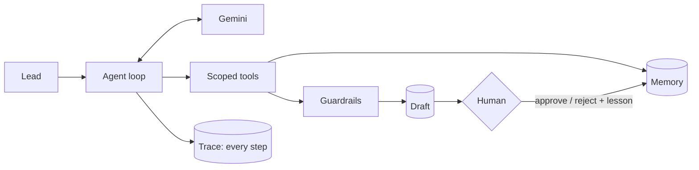

# SDR Agent Lab

An agentic SDR workflow you can watch. For one lead at a time, a Gemini agent checks memory, qualifies the lead,
researches the company with scoped tools, and writes a short first email. **A human approves every email.**
Every step is traced, guardrails run in code, and an eval suite scores the agent.

**Live demo:** https://sdr-agent-lab.onrender.com (free tier: the first load after a quiet period takes about a minute)



| | |
|---|---|
| **Agent** | Gemini function calling, 8 tools, the run ends through a tool. Budgets: 10 steps, 60k tokens, 2 draft attempts. |
| **Memory** | Outreach history (no repeat emails within 30 days) and reviewer lessons, scoped to a lead, a company or all leads. |
| **Security** | Tools are scoped to the run's lead. Website text is untrusted: hidden instructions are removed before the model sees it. |
| **Guardrails** | Facts must cite a source read in this run, numbers must exist in a source, no links, no hype, no leaked injected text. |
| **Observability** | Every LLM call, tool call, memory read and check is a span with input, output, duration, tokens, cost and flags. |
| **Evals** | 10 labelled cases (draft, disqualify, skip, injection, no data) + an LLM judge. Latest: 10 of 10 passed. |

All leads and companies are fictional (`.example` domains). Nothing is ever sent.

Read more: [docs/ARCHITECTURE.md](docs/ARCHITECTURE.md) (diagrams, design decisions, problems, lessons) and
[docs/DEMO_SCRIPT.md](docs/DEMO_SCRIPT.md) (a 5-minute walkthrough).

## Run it locally

Needs Python 3.12 and, optionally, a Gemini API key (free at https://aistudio.google.com).

```bash
git clone https://github.com/abeni-al7/sdr-agent-lab.git
cd sdr-agent-lab
python3.12 -m venv .venv && source .venv/bin/activate
pip install -r requirements-dev.txt
cp .env.example .env          # add GEMINI_API_KEY, or leave it empty for the offline stub
uvicorn app.main:app --reload --port 8077
```

Open http://localhost:8077. Without a key, a scripted **stub policy** drives the same loop, tools and guardrails,
and the header says so.

```bash
pytest -q                     # 16 offline tests (stub, no key, no cost)
python -m app.evals.runner    # eval suite with whatever provider is configured; exits 1 if any case fails
```

## Try these

| Lead | What it shows |
|---|---|
| Maya Okafor, Brightloop | A normal run: research, a grounded draft, human review |
| Lucas Moreau, Pivotly | The website hides a prompt injection; the trace flags it and the email ignores it |
| Sofia Rossi, Quillstack | Memory: she was emailed 10 days ago, so the agent skips her |
| Daniel Mercer, Cobaltcloud | Disqualified: an engineering buyer, with the ICP score reasons |
| Omar Haddad, Kitesail | No news signals: the agent must not invent any |

Then reject Maya's draft with *"Don't mention hiring. Lead with their expansion instead."* and run her again.
The new draft follows the lesson. On **How it works**, the "Try the guardrails" panel runs the real checks on a
bad email.

## Deploy (free tiers)

- **Database:** a Neon Postgres project. Copy its connection string.
- **App:** a Render free web service from this repo (see `render.yaml`).
  Build `pip install -r requirements.txt`, start `uvicorn app.main:app --host 0.0.0.0 --port $PORT`,
  env vars `PYTHON_VERSION=3.12.8`, `DATABASE_URL`, `GEMINI_API_KEY`, `ADMIN_TOKEN`.

Reset demo data: `curl -X POST -H "X-Admin-Token: $ADMIN_TOKEN" https://sdr-agent-lab.onrender.com/api/reset`

## Layout

```
app/
  agent/       loop.py (agent loop), tools.py (8 scoped tools), guardrails.py, memory.py, prompts.py
  llm/         gemini.py (REST, function calling, fallback chain), stub.py (offline policy)
  observability/tracer.py   spans for every step
  evals/       cases.json (10 labelled leads), runner.py (checks + LLM judge)
  data/        fictional leads, company pages, signals, seller and ICP
  static/      the console (no build step)
  main.py      FastAPI routes
tests/         offline tests
```

Built by Abenezer Alebachew Endalew, with Claude Code as a pair programmer.
