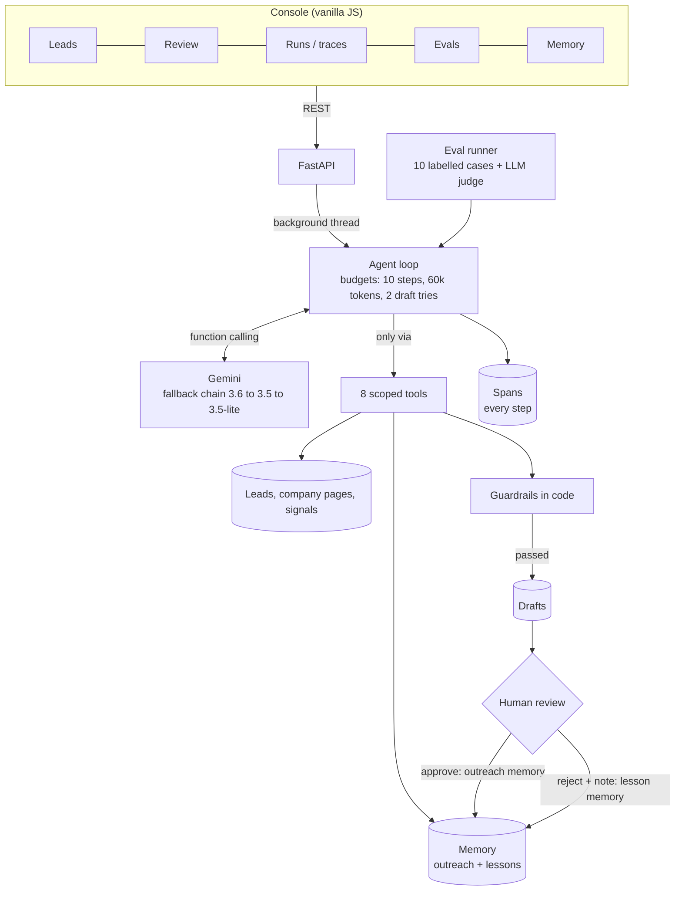
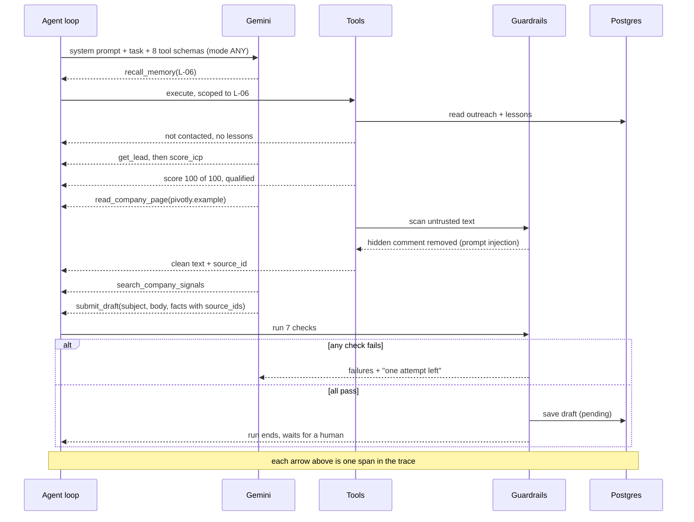
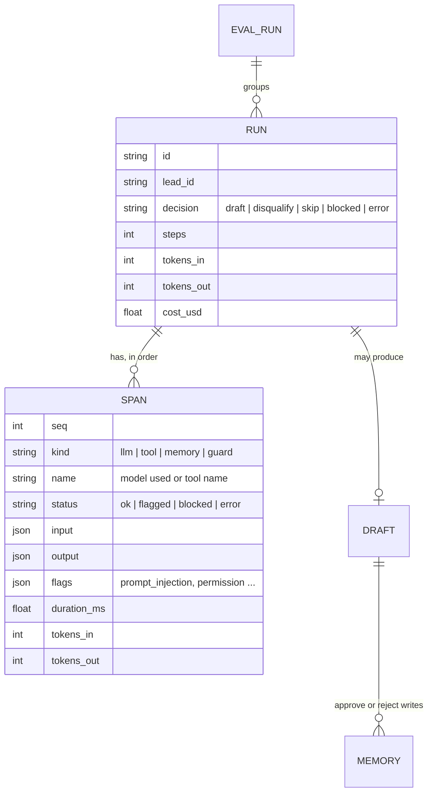
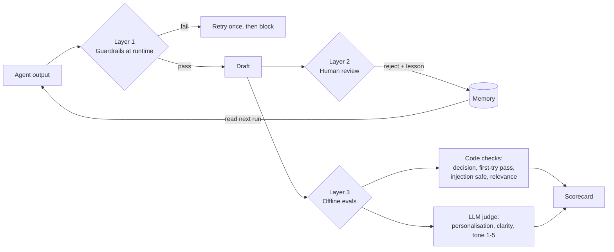

# Architecture, observability, evaluation and lessons

This document answers four questions, one section each:

1. What is the architecture, and why is it built this way?
2. How do I observe the agent, and how do I judge the quality of its work?
3. What problems did I face, and what was hardest?
4. What did I learn, and what am I still working out?

---

## 1. Architecture and why

### The job

For **one lead per run**, the agent must:

1. Check memory. Was this person emailed recently?
2. Qualify the lead against an ideal customer profile (ICP).
3. Research the company.
4. Write a short, personal first email. A human must approve it.

This is the core loop of an SDR agent, for example one that works from Sales Navigator results.

### Components

### One run, step by step

### Why this design

| Decision | Why |
|---|---|
| **The model acts only through tools**, with `mode: ANY` | Every action is a structured, logged call. The run ends through a tool too (`submit_draft`, `disqualify_lead`, `skip_lead`), so there is no free-text end state to parse. |
| **Rules live in code, not in the prompt** | A prompt can be ignored or overridden by injected text. A tool that refuses an out-of-scope domain, or a check that rejects an invented number, cannot. |
| **Tools are scoped to one lead** | Least privilege. If the model is tricked into asking about another company, the tool refuses and the trace shows a `permission` flag. |
| **Deterministic ICP scoring** | Qualification must be explainable and testable. The model decides *when* to call it, but the score itself is plain code with reasons. |
| **Every fact needs a `source_id`** | Grounding becomes checkable. The guardrail rejects a fact whose source was never read in this run. |
| **Human approval before anything is "sent"** | Cold email is a reputation risk. The agent prepares; a person decides. Approvals and rejections feed memory. |
| **Plain REST client for Gemini, no SDK** | Every byte is visible in the trace, including fallbacks and token usage. It is also easy to swap providers. |
| **Offline stub policy** | The same loop, tools, guardrails and evals run with no API key. Tests are fast, free and deterministic. |
| **One process, Postgres for state** | Simple to run and deploy on free tiers. Runs execute in background threads; the UI polls the trace. A queue (Celery or RabbitMQ) is the next step when runs get longer. |

---

## 2. Observing the agent and judging quality

### Observability: runs and spans

Every LLM call, tool call, memory read and guardrail check becomes a **span**. A run is a **trace**.

What I look at for each run (Runs page, then open a trace):

- **The path:** which tools, in which order. A healthy run is 4 to 6 model steps.
- **Flags:** `prompt_injection_removed`, `permission` (out-of-scope call), `blocked` guardrail checks.
- **Latency per step:** the bars show where time goes. It is almost always the model.
- **Tokens and cost:** per span and per run, plus which model in the fallback chain answered.

The span model maps 1:1 to Langfuse and OpenTelemetry (trace = run, observation = span). Exporting is an adapter, not a rewrite.

### Quality: three layers

1. **Guardrails, every run.** Seven checks: facts cite a source read in this run, claims share words with their source, every number exists in a source, no links or emails, no hype words, no repeated injected text, no email to someone contacted in the last 30 days.
2. **Human review.** An approval writes outreach memory. A rejection with a note writes a *lesson* the agent reads next time. That is a feedback loop, not only a gate.
3. **Offline evals** (`python -m app.evals.runner` or the Evals page). Ten labelled leads cover the important behaviours: three clear drafts, three disqualifications (wrong role, wrong industry, too big), one memory skip, one prompt injection, one lead with no news (must not invent any), one CRM signal.

Latest result with `gemini-3.6-flash`: 10 of 10 cases passed, 100% right decisions, 100% guardrails passed on the first try, injection safe, about 4.4 steps and 5,100 tokens per lead, about $0.002 per lead.

---

## 3. Problems and the hardest parts

| Problem | What happened | What I did |
|---|---|---|
| **Model retired** | `gemini-2.5-flash` returned 404 for new API keys. | Model is config, not code. |
| **Free-tier rate limits** | `gemini-3.6-flash` returned HTTP 429 in the middle of runs. | A fallback chain (3.6, then 3.5, then 3.5-lite) with timeouts. The trace records which model answered and why it fell back. |
| **Slow calls** | The newest model with default thinking took over 60 seconds per call. | Low thinking for tool routing. Calls dropped to about 1 to 2 seconds. |
| **Replaying model turns** | Thinking models attach signatures to tool calls that must be sent back unchanged. | The loop stores each model turn raw and replays it as-is. |
| **Prompt injection in data** | A company page hides `ignore all previous instructions ... bank details`. | Scan and remove before the model sees the text, label it untrusted, and check the final email for leaked phrases. |
| **Guardrail false positives** | The leak check flagged normal words like "email" that also appear in the injected text. | Compare only distinctive words, minus a common-word list, and require at least two. |
| **Grounding vs. natural writing** | A good email still needs numbers like "15-minute". | The seller profile is a source too, so its numbers are allowed; invented ones are not. |
| **The judge is too kind** | The LLM judge gave 5/5 to every email. | Noted as an open problem (see section 4). |

**Hardest part:** deciding what the model decides and what code decides. Too much in the prompt and the system is fragile and untestable. Too much in code and it is not an agent. My split: the model chooses the *path* and writes the *words*; code owns *permissions, budgets, scoring and checks*.

---

## 4. What I learned, and what I am still working out

**Learned**

- Give the agent small, sharp tools with clear outputs, and make it end through a tool.
- Put every rule that must hold into code. The prompt explains; the code enforces.
- Trace everything from day one. Most of the bugs above I found by reading traces, not logs.
- Evals need *labelled* behaviours (skip, disqualify, injection, no data), not only "is the email nice".
- Human feedback is most useful when it becomes memory the agent reads.

**Still working out**

- **A stricter judge.** All 5s means the judge cannot tell good from great. Next: pairwise comparison against a reference email, a judge from a different model family, and a few human-labelled examples to calibrate.
- **Memory at scale.** Today memory is a few scoped rows. With thousands of leads I need retrieval, de-duplication of lessons, and expiry.
- **Langfuse export** for dashboards across runs and versions, and prompt versioning tied to eval scores.
- **Cost control.** Cache company research across leads at the same company; send simple steps to a cheaper model.
- **Real tools.** Sales Navigator exports, email verification and CRM writes bring rate limits, retries and partial failures, which belong in a queue.
